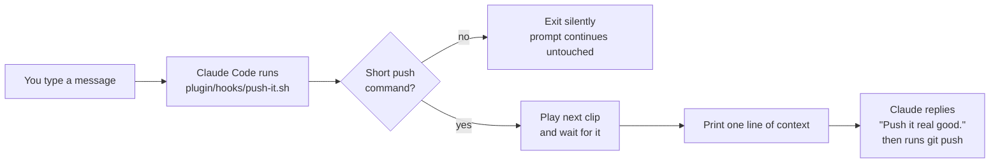

# Architecture

Push it is one small shell script wired into Claude Code's `UserPromptSubmit` hook. This page explains how it works and why each decision was made, so you can change it without breaking the parts that matter.

## Flow

The hook never pushes anything itself. It only tells Claude what to do, so pushing goes through Claude's normal tool use and permission prompts.

## Layout

| Path | Role |
| --- | --- |
| `.claude-plugin/marketplace.json` | Makes this repo its own one-plugin marketplace, so `/plugin marketplace add chromaglow/push-it` works. |
| `plugin/` | **The shipped artifact.** Only this folder is copied to users' machines; tests, docs and CI stay in the repo. |
| `plugin/.claude-plugin/plugin.json` | Plugin identity: name, version, author, license. |
| `plugin/hooks/hooks.json` | Registers the hook with Claude Code when installed as a plugin. |
| `plugin/hooks/push-it.sh` | **All runtime behavior.** Matching, config, clip rotation, playback and the message to Claude. |
| `plugin/config/push-it.conf` | Defaults. A user copy at `~/.claude/push-it/push-it.conf` overrides it. |
| `plugin/sounds/` | Bundled clips. User clips in `~/.claude/push-it/sounds/` replace them. |
| `scripts/` | Fallback installer and uninstaller for setups without plugins, plus their shared helpers. |
| `tools/clip-trimmer.html` | Standalone browser tool for making a WAV clip. |
| `tests/` | Shared trigger cases, the bash suite and the Windows installer test. |

## Design decisions

**One hook for every OS.** On Windows, Claude Code runs hook commands through Git Bash, which anyone pushing to GitHub already has. So a single bash script serves Windows, macOS and Linux, and only *playback* branches by platform (`afplay`, PowerShell's `SoundPlayer`, `paplay` or `aplay`). The earlier version kept separate PowerShell and shell hooks, and the trigger list had already drifted between them.

**No runtime dependencies.** The hook doesn't use Node, Python or `jq`, since none of them is guaranteed to exist on every machine. It pulls the `prompt` field out with a bash regex. That isn't a general JSON parser, and it doesn't need to be: it only has to decide whether the whole message is a push command. Escapes are left in place on purpose. An escaped newline or tab means a multi-line message, and those never fire. The malformed-input tests cover the edge cases.

**Cheap on every message.** The hook runs on every prompt, and starting processes is slow in Git Bash on Windows. So the first thing it does, using only bash builtins, is check whether the input contains "push" at all; if not, it exits without starting a single extra process. Config loading and matching only happen for the rare message that passes.

**Never block a prompt.** The hook always exits 0 and stays silent when it doesn't fire, even on bad input. A sound effect must never get between someone and Claude.

**Strict matching, because a false positive pushes code.** A message fires only if it's a single line, its first word is "push", it has at most 6 words, and *every* other word is on `allowed_words`. So `push it to main` fires, while `push back on that idea`, `push the meeting to friday` and `push my luck` don't. An earlier design checked only the second word, which let phrases like those through. `two` and `too` are on the list because voice dictation often hears "push to" that way.

**Synchronous playback.** Claude Code cleans up anything a hook leaves running in the background, which cut clips off mid-play. So the hook waits for the clip, about 2 seconds, and only then hands control back. The 10-second timeout leaves room for PowerShell's slow start on Windows.

**WAV only.** It's the one format that plays everywhere with built-in tools, including Windows' `SoundPlayer`.

**Push only by default.** A hook that silently commits other people's work is a surprise no one wants from a fun add-on. With `auto_commit=false`, Claude points out uncommitted changes and offers to commit them. Turning on `auto_commit=true` is an explicit opt-in.

**Context, not a CLAUDE.md rule.** The hook's output goes straight into Claude's context, so nothing has to be added to the user's `CLAUDE.md`. The pre-1.0 kit appended a rule there. The installers now remove it, since editing someone's personal instructions was the most invasive part of the old design.

**User files live outside the plugin.** Plugin folders are replaced on every update, so custom sounds and config go in `~/.claude/push-it/`, and clip rotation state goes in `$CLAUDE_PLUGIN_DATA`. Updates and uninstalls never touch the user's own files.

**Shipped artifact separate from the repo.** The marketplace points at `./plugin`, so installing copies only the hook, config and sounds. Tests, docs and CI never land on users' machines, and the fallback installers copy from the same folder, so both install paths ship identical files.

**Plugin first, installer as fallback.** The plugin system installs, updates and removes cleanly without editing `settings.json`. The fallback installers exist for setups without plugin support. They merge rather than overwrite, back up before every change, are safe to rerun, upgrade the pre-1.0 kit in place, and refuse to install over the plugin, since both together would play the sound twice.

**Surgical settings merge.** The installers only ever add or remove push-it's own hook command, matched by its exact path (and the pre-1.0 kit's file names). They never remove whole hook groups or anything that merely looks similar, such as a user's own `git-push-hook.sh`. If `settings.json` isn't valid JSON, they stop and leave it untouched.

**Settings merge per platform.** `scripts/merge-settings.js` runs under macOS's built-in JavaScript (`osascript -l JavaScript`) or Node, so macOS needs nothing installed; Linux needs Node. Windows uses the PowerShell version in `scripts/lib.ps1`. The two follow the same rules and are checked by matching cases in `tests/run.sh` and `tests/test-install.ps1`. One known difference: Windows PowerShell 5.1 reformats JSON and escapes characters like `&` as `\u0026`. The result is equivalent, and a backup is always written first.

## Testing

- `tests/trigger-cases.tsv`: one table of "message → should it fire?" that every implementation must pass.
- `tests/run.sh`: hook behavior (triggers, multi-line and malformed input, config with CRLF and stray spaces, clip rotation, custom sounds) plus a full install → rerun → uninstall round trip in a throwaway home folder. That includes the upgrade from the pre-1.0 kit, keeping look-alike user hooks, refusing to double-install over the plugin, and invalid `settings.json`.
- `tests/test-install.ps1`: the same installer cases for Windows, under both Windows PowerShell 5.1 and PowerShell 7.
- CI runs all of it on Windows, macOS and Linux, plus ShellCheck, PSScriptAnalyzer and `claude plugin validate`. On macOS the installer uses `osascript`, so CI covers that path too.

Audio playback can't be tested on CI servers, so tests set `PUSHIT_NO_SOUND=1`. The hook then logs which clip it would have played instead of playing it.
